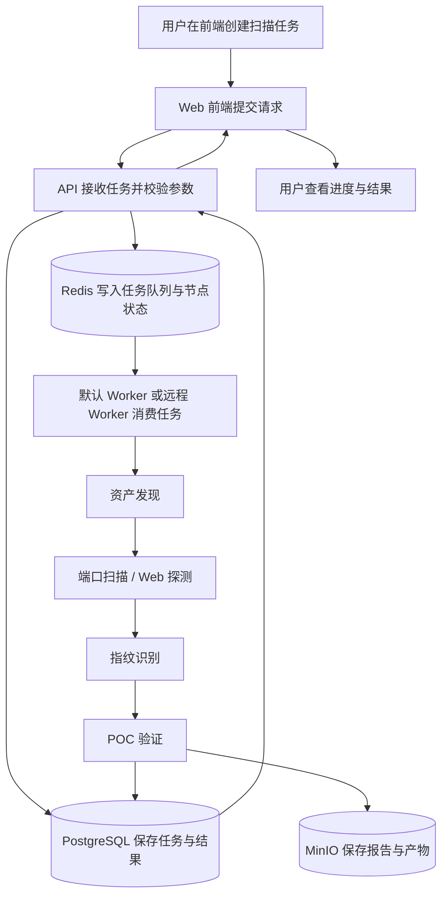
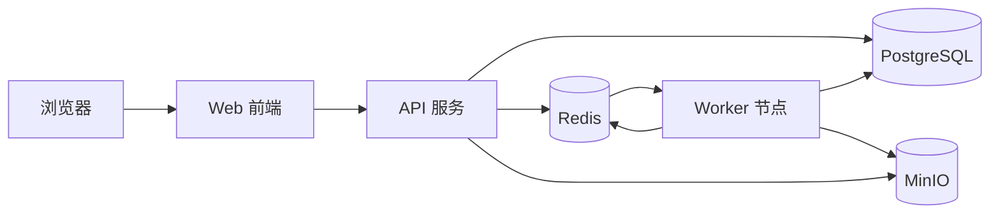
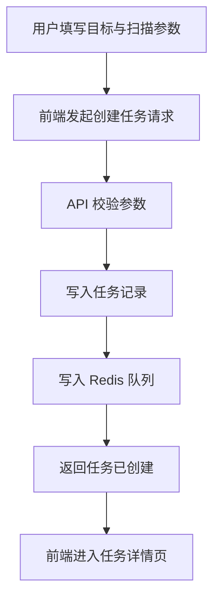
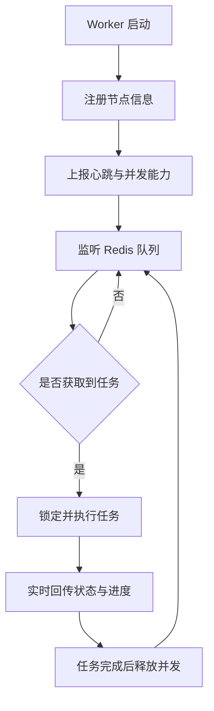
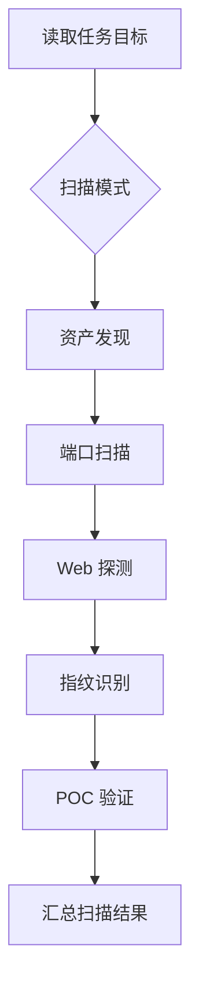
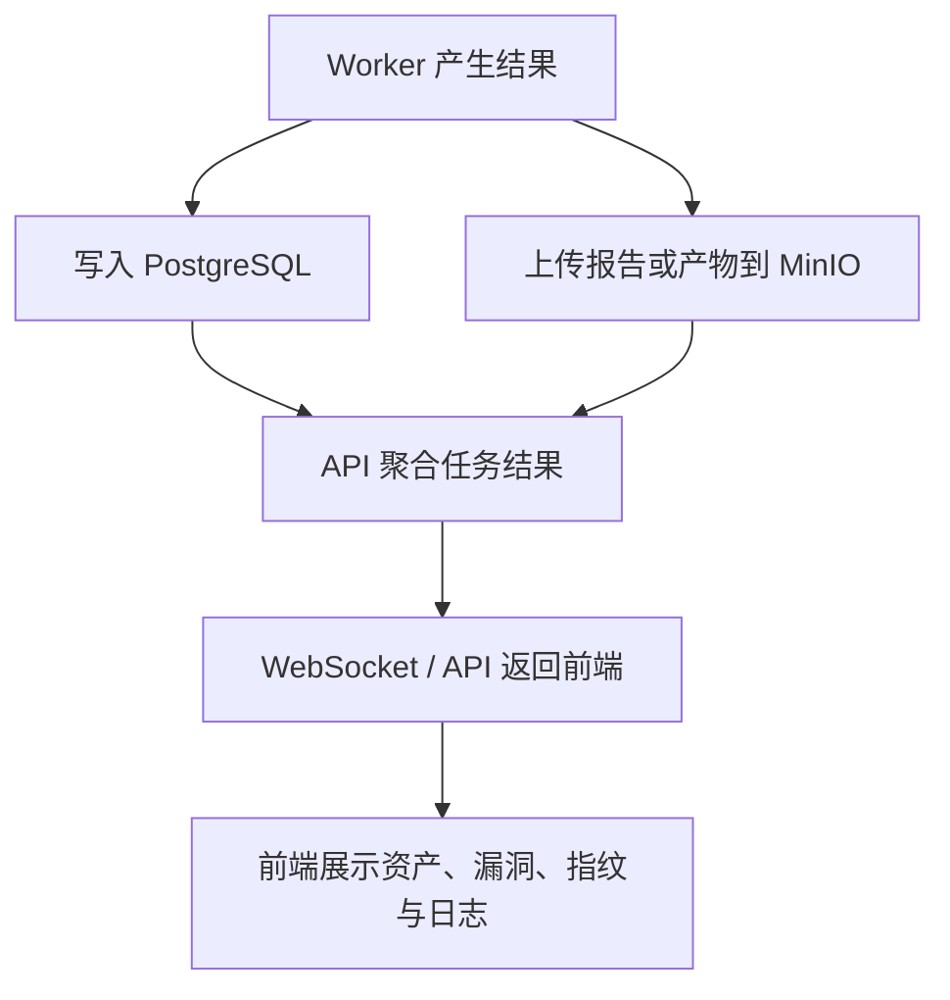
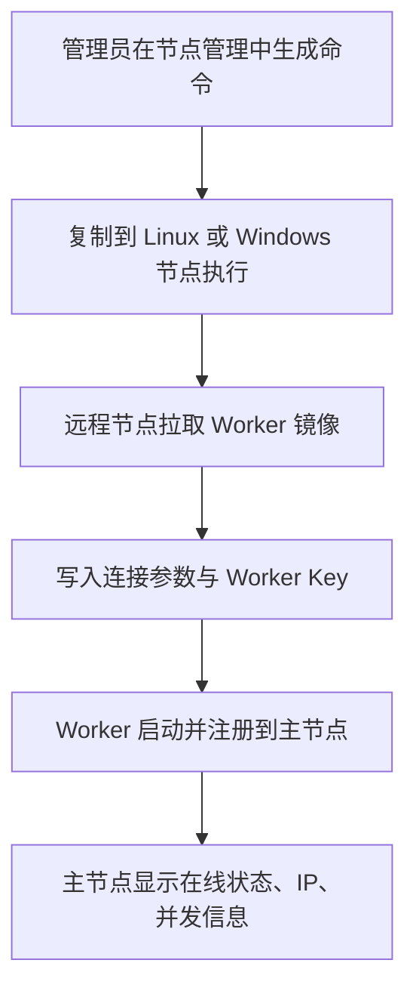
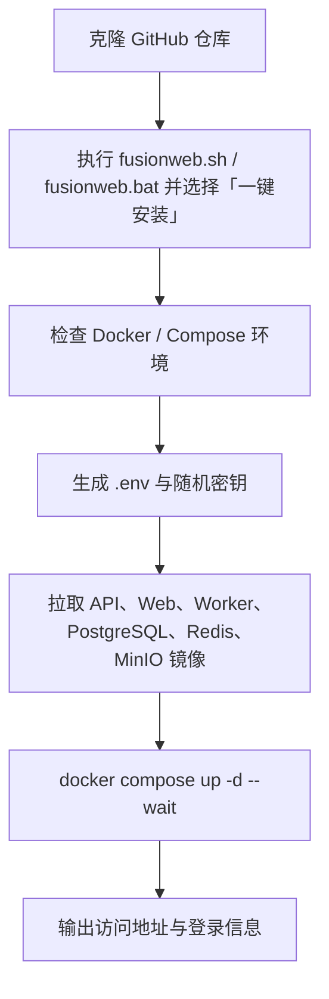

# FusionWeb

FusionWeb 是一个面向资产发现、端口扫描、Web 指纹识别、POC 验证与结果分析的安全扫描一体化平台，提供前端控制台、后端 API、默认 Worker 与一键部署脚本，支持本机扫描、远程节点管理和容器化生产部署。

## 项目概览

- **前端**：基于 Next.js + TypeScript 的安全扫描控制台
- **后端**：Go 编写的 API 与扫描流程服务
- **Worker**：独立扫描执行节点，支持单节点并发控制
- **存储**：PostgreSQL、Redis、MinIO
- **部署**：Linux / Windows 一键脚本 + Docker Compose

## 核心能力

- 资产发现与目标管理
- 端口扫描、Web 探测与指纹识别
- POC 验证与漏洞结果展示
- Worker 节点管理、名称修改与并发配置
- 默认本机 Worker 自动消费扫描流程
- 远程 Worker 一键部署与接入
- 生产环境镜像化部署
- Linux / Windows 交互式管理脚本：安装、升级、卸载、状态、日志、启停、重启、检查更新

## 软件总体流程图



## 分流程图说明

### 1. 系统架构流程图



### 2. 扫描任务创建流程图



### 3. Worker 消费任务流程图



### 4. 扫描执行流程图



### 5. 结果写入与展示流程图



### 6. 远程 Worker 接入流程图



### 7. 一键部署流程图



## 技术栈

- **前端**：Next.js、React、TypeScript、Tailwind CSS
- **后端**：Go、Gin
- **基础设施**：Docker、Docker Compose、PostgreSQL、Redis、MinIO

## 安装部署

### 方式一：一键安装脚本（推荐）

Linux / macOS：

```bash
git clone https://github.com/HuanXiong031/FusionWeb.git
cd FusionWeb
./fusionweb.sh
```

Windows（PowerShell）：

```bat
git clone https://github.com/HuanXiong031/FusionWeb.git
cd FusionWeb
fusionweb.bat
```

脚本启动后进入交互式管理菜单，输入数字选择对应操作：

```text
  1. 一键安装
  2. 一键升级
  3. 一键卸载
  4. 查看状态
  5. 查看日志
  6. 启动服务
  7. 停止服务
  8. 重启服务
  9. 检查更新
  0. 退出
```

选择 `1` 执行一键安装后会自动完成：检查 Docker / Docker Compose 环境 → 生成 `.env` 与随机密钥 → 拉取 API、Web、Worker、PostgreSQL、Redis、MinIO 六个镜像 → `docker compose up -d --wait` → 校验容器状态并输出访问地址与登录信息。

### 方式二：Docker Compose 手动部署

```bash
git clone https://github.com/HuanXiong031/FusionWeb.git
cd FusionWeb
cp .env.example .env
# 按需修改 .env：镜像前缀、端口、数据库/Redis/MinIO 密码、Worker Key、JWT 密钥等
docker compose --env-file .env pull
docker compose --env-file .env up -d
```

镜像托管在阿里云 ACR。若仓库未开放匿名拉取，先执行 `docker login <registry-host>` 登录，`<registry-host>` 即 `.env` 中 `FUSIONWEB_IMAGE_PREFIX` 的域名部分。

### 方式三：源码开发模式（本机构建）

使用源码构建覆盖层，在本机重新编译 API、Web、Worker 镜像：

```bash
git clone https://github.com/HuanXiong031/FusionWeb.git
cd FusionWeb
cp .env.example .env
docker compose -f docker-compose.yaml -f docker-compose.dev.yaml --env-file .env up -d --build
```

### 访问与登录

- Web 控制台：`http://<服务器IP>:8756`，或 HTTPS `https://<服务器IP>:8988`
- 一键脚本安装完成后会输出访问地址与登录信息
- 首次安装会自动生成管理员密码并写入 `fusionweb_secrets` 卷；生产环境请在首次登录后立即修改密码

## 目录结构

```text
api/        后端 API
backend/    核心业务与公共模块
frontend/   Web 前端
worker/     Worker 执行器
```


## AI、钉钉机器人与凭据安全

系统设置中的 **AI API Key**、统一 **钉钉机器人**凭据均使用服务端 AES-256-GCM 加密后写入数据库，前端只显示脱敏状态。生产环境必须在 API 服务和执行迁移的所有实例中固定设置：

```dotenv
FUSIONWEB_ENCRYPTION_KEY=<长度足够且随机的固定密钥>
```

不要在部署后随机重新生成该值。密钥改变或丢失后，历史 AI Key、钉钉 Client Secret、Webhook Token 等密文将无法解密，需要重新录入；旧数据库不会自动恢复明文凭据。部署脚本只负责传递环境变量，不会把密钥写入代码或日志。

钉钉功能统一在“系统设置 → 钉钉机器人”管理：

- 配置 Stream Client ID/Secret 后接收 `@机器人` 消息；
- 配置 Webhook Token/Secret，或配置默认群聊/用户通知目标，发送主动通知；
- 通过绑定码绑定 FusionWeb 用户，再按用户和群聊白名单放行任务创建与 AI 对话；
- 机器人任务创建会保存机器人 ID、会话 ID和源消息 ID，同一消息重试不会重复创建任务；
- 旧 `dingtalk_keys` 会在启动时迁移为“仅通知机器人”，迁移失败会保留原始配置并记录日志。

如果机器人只有 Stream 入站配置而没有出站 Webhook 或默认通知目标，仍可创建任务和进行 AI 对话，但不会发送主动任务完成通知，页面会显示“未配置通知目标”。
