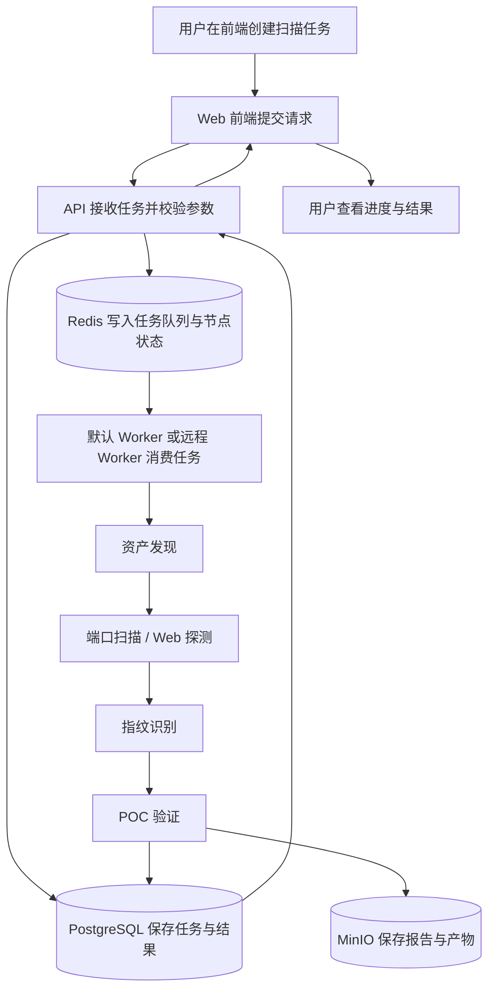
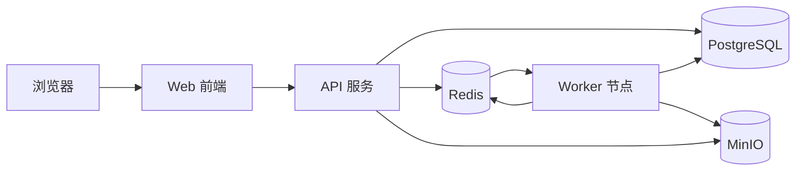
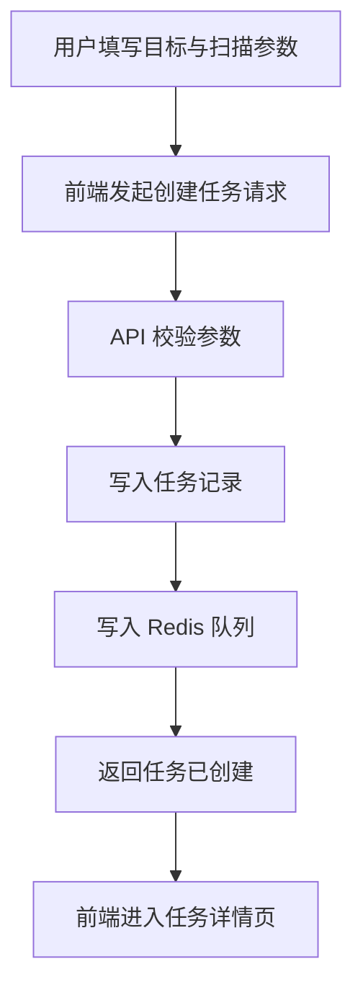
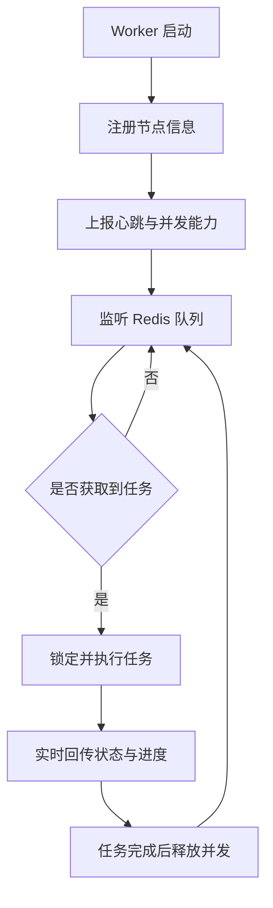
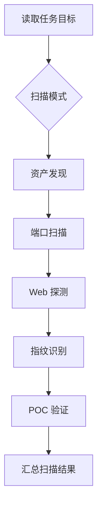
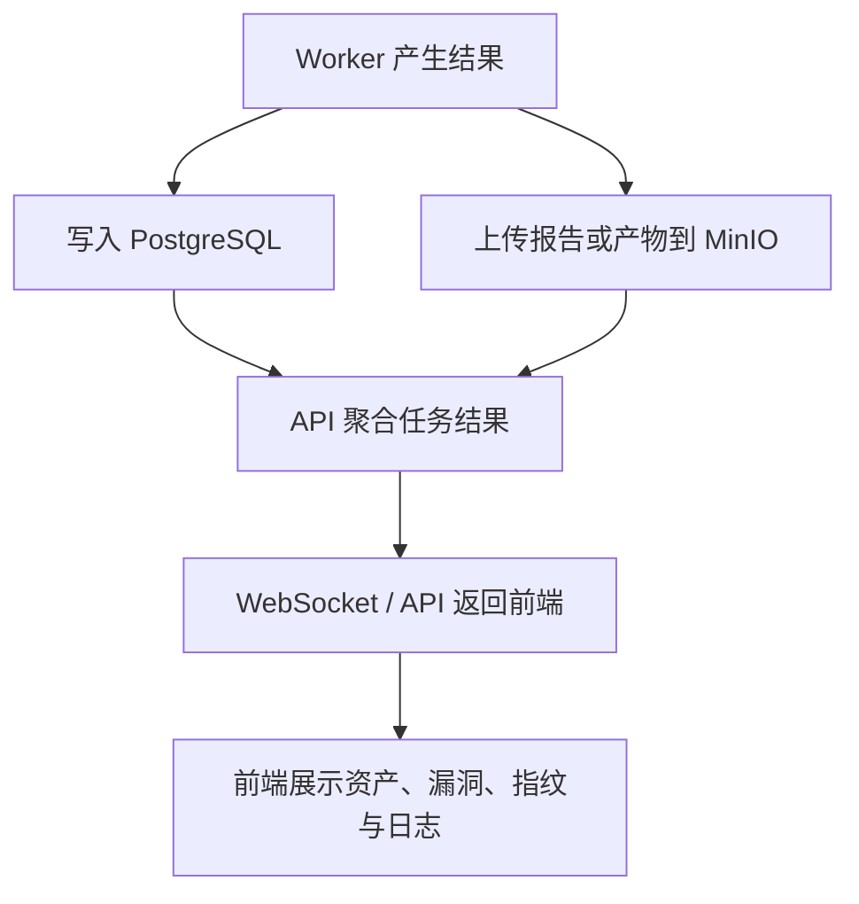
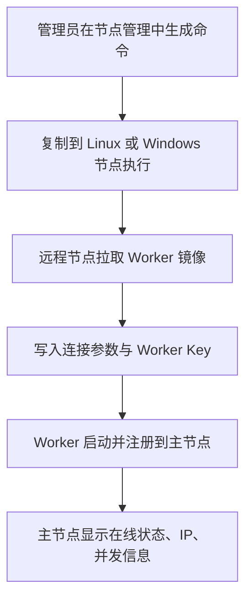
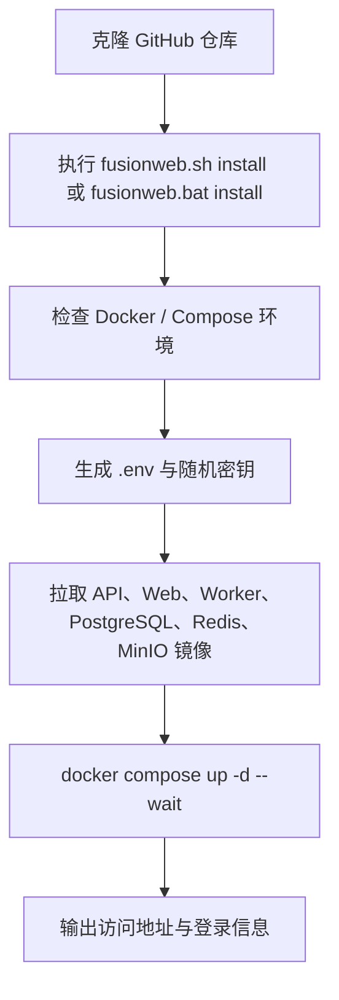

# FusionWeb

FusionWeb 是一个面向资产发现、端口扫描、Web 指纹识别、POC 验证与结果分析的安全扫描一体化平台，提供前端控制台、后端 API、默认 Worker 与一键部署脚本，支持本机扫描、远程节点管理和容器化生产部署。

## 项目概览

- **前端**：基于 Next.js + TypeScript 的安全扫描控制台
- **后端**：Go 编写的 API 与扫描流程服务
- **Worker**：独立扫描执行节点，支持单节点并发控制
- **存储**：PostgreSQL、Redis、MinIO
- **部署**：Linux / Windows 一键脚本 + Docker Compose

## 核心能力

- 资产发现与目标管理
- 端口扫描、Web 探测与指纹识别
- POC 验证与漏洞结果展示
- Worker 节点管理、名称修改与并发配置
- 默认本机 Worker 自动消费扫描流程
- 远程 Worker 一键部署与接入
- 生产环境镜像化部署
- Linux / Windows 管理脚本：安装、升级、状态、日志、卸载

## 软件总体流程图



## 分流程图说明

### 1. 系统架构流程图



### 2. 扫描任务创建流程图



### 3. Worker 消费任务流程图



### 4. 扫描执行流程图



### 5. 结果写入与展示流程图



### 6. 远程 Worker 接入流程图



### 7. 一键部署流程图



## 技术栈

- **前端**：Next.js、React、TypeScript、Tailwind CSS
- **后端**：Go、Gin
- **基础设施**：Docker、Docker Compose、PostgreSQL、Redis、MinIO

## 快速开始

### 生产部署

```bash
./fusionweb.sh install
```

Windows 环境使用：

```bat
fusionweb.bat install
```

### 开发模式

```bash
docker compose -f docker-compose.yaml -f docker-compose.dev.yaml --env-file .env up -d --build
```

## 目录结构

```text
api/        后端 API
backend/    核心业务与公共模块
frontend/   Web 前端
worker/     Worker 执行器
```
